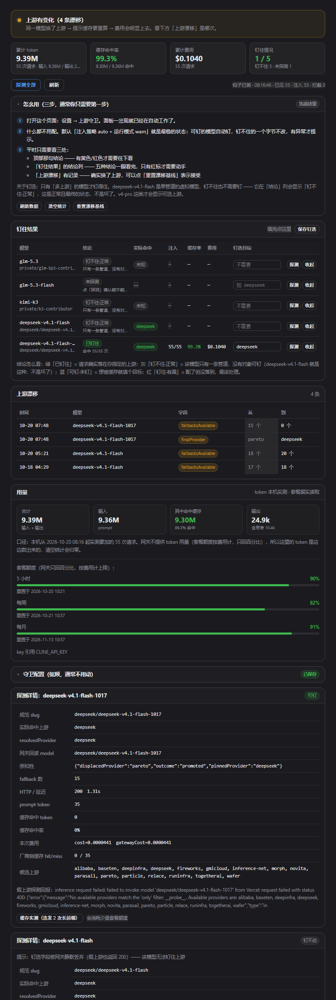

# dsh-clinepass-guard

Cline Pass 上游守卫 for DeepSeek Harness。**注入 + 观测 + 漂移告警**三合一。

面板位置：**设置 → 上游守卫**



一句话说清它值在哪：Cline Pass 背后是多渠道池，**上游一换，提示缓存就全部重算**——
实测同一段 31k 前缀，命中缓存的第二次比第一次便宜约 **24 倍**。把上游钉住不是洁癖，是钱。

---

## 三步上手

> **通常你只需要第 1 步。** 默认配置（注入 `auto` + 模式 `warn`）已经是最稳的状态：
> 能钉的模型自动钉，钉不动的一个字节都不改，只有出异常才提示。

1. **打开面板**：设置 → 上游守卫。打开即在工作中，不需要点任何开关。
2. **什么都不用配**。随便发几条 `cline-pass/*` 的消息，面板自己长出数据。
3. **平时只看三处**：
   - 顶部**那句话说结论** —— 绿色不用管，黄/红色才需要往下看；
   - **「钉住结果」的结论列** —— 五种结论一眼看完，红标才需要动手；
   - **「上游漂移」有记录** —— 确实换了上游，点「重置漂移基线」表示接受。

**想看「一共花了多少 token」** → 看顶部第一个数字「累计 token」，或「用量」区块的明细
（输入 / 其中命中缓存 / 输出 / 合计）。注意这是**本机实测累加**，不是网关给的
——网关只回套餐百分比，原因见下文「token 用量的口径」。

**为什么 `deepseek-v4.1-flash` 显示「钉不住·正常」，是不是坏了？** 不是，这是**正常且最终的状态**。
它是单管道的虚拟模型（`fallbacksAvailable` 为空、`cost=0`），本来就没有第二个上游可选 ——
没有对象可钉。面板对它只做观测与漂移守护。**只有 v4-pro 这类多上游模型才会显示候选上游。**

### 想手动钉一个模型

1. 在「钉住结果」里找到模型 → 点 **探测**，看结论列：
   - **可钉·未钉 / 已配·待验证** → 「钉选目标」里填上游名（如 `deepseek`，多个用逗号分隔）→ 点 **保存钉选**；
   - **钉不住·正常** → 留空即可，`auto` 策略下不会给它注入任何东西。
2. 盯住结论列：从「已配·待验证」变成 **「已钉住」** 就说明真的生效了；
   「注入」列的 `2/3` 表示 3 次请求里有 2 次真的落在你指定的上游；变成
   **「钉住·有漏」** 则说明配了但没落到，需要看详情。

### 钉哪个上游？（有实测数据）

**关键只有一条：这个上游做不做前缀缓存。** 做，钉上去便宜二十倍；不做（命中率 0%），
钉上去等于每次全价，**比不钉还糟**。

2026-10-20 对 `deepseek-v4.1-flash-1017` 的 16 个候选实测（同一段 18k 前缀连发两次）：

| 结论 | 上游 |
|---|---|
| ⭐ 推荐 | `deepseek`（第一方，98.9%）、`togetherai`（99.6%，**0.74s 最快**）、`fireworks`、`inference-net`、`wafer`、`deepinfra` |
| 可用 | `alibaba`、`novita`、`parasail`… 见文档 |
| ❌ 不缓存，别钉 | **`parasail`（0%）、`particle`（0%）** |
| ❌ 当前调不通 | `baseten`、`azure`、`morph` |

完整数据、测法、以及「为什么默认选第一方」见
[**docs/upstream-selection.md**](docs/upstream-selection.md)。

> 换模型一定要重测：`deepseek-v4-pro` 只有 6 个候选，且这批结论不适用于它。

### 面板从上到下是什么

| 区块 | 回答什么 | 平时要不要看 |
|---|---|---|
| 顶部结论条 | 现在有没有问题（一句话） | **要** |
| 四个数字 | **累计 token** / 缓存命中率 / 累计费用 / **钉住情况** | **要** |
| 怎么用 | 这份三步说明（默认展开，点标题可收起） | 第一次看 |
| **钉住结果** | 一行一个模型：**钉住没有（结论）** → 实际落在哪 → 注入命中 → 缓存率/费用 → 填钉选目标 + 探测/详情 | **主要就看这张表** |
| 上游漂移 | 管道/上游什么时候变的（有漂移才出现） | 有告警时看 |
| **用量** | 本机累计 token 明细（输入/缓存/输出/合计）+ 套餐三窗口百分比 | 偶尔 |
| 守卫配置 | 注入策略、运行模式、观测开关 | 低频 |
| 操作历史 | 面板上做过的动作流水 | 排查时看 |

**「钉住结果」的结论只有五种**，互斥且穷尽（顺序即优先级）：

| 结论 | 含义 | 要做什么 |
|---|---|---|
| 🟢 已钉住 | 请求确实落在你指定的上游 | 不用管 |
| ⚪ 钉不住·正常 | 单管道模型，没有第二个上游可钉 | 不用管（不是坏了） |
| 🔵 可钉·未钉 | 有多条管道，但你没配目标 | 想省缓存就填一个 |
| 🟡 已配·待验证 | 配了但还没有请求经过 | 发一条消息验证 |
| 🔴 钉住·有漏 | 配了，但请求没落到指定上游 | **该处理**，缓存正在被切碎 |

### token 用量的口径（重要）

**网关不提供 token 用量。** `/users/me/plan/usage-limits` 只回 `percentUsed` 与 `resetsAt`，
试过的 `/users/me/usage`、`/users/me/plan/usage` 等全是 404；而且套餐额度（`inferenceCapThreshold`）
是按**费用**（USD）设上限的，不是按 token。

所以面板里的 token 是**本机实测累加**的：旁路读每条 SSE 的 `usage.prompt_tokens` /
`prompt_tokens_details.cached_tokens` / `completion_tokens`，按模型累加后求和。
口径与边界：

- **合计 = 输入 + 输出**（`cached` 是输入的**子集**，不能重复加）；
- 只覆盖本机经过 DSH 的请求，从「统计起点」开始（面板上写着具体时间）；
- 点「清空统计」会归零并重置起点；
- 想跟套餐百分比对齐，只能看趋势，**不能相加**——两者分子不同。

---

## 它解决什么问题

Cline Pass 的订阅模型背后是 Cline 网关 + Vercel AI Gateway 的多渠道池。同一个模型每次请求
可能落到不同上游，而**上游一换，提示缓存就重算**——实测同一段 31k 前缀，第二次命中缓存时
便宜约 24 倍。所以「把上游钉住」不是洁癖，是钱。

这个插件做两件事：

1. **注入**：在发往 `api.cline.bot` 的 `/chat/completions` 请求体上按模型写入
   `providerOptions.gateway.only`（这是唯一被网关透传的钉选写法；顶层 `provider.only` 会被丢弃）。
2. **观测**：用 `res.clone()` 旁路读回每条**真实**请求的路由元数据，并检测漂移。

---

## ⚠️ 先读这一段：不是所有模型都能钉

**「能不能钉住」是模型属性，不是配置问题。** 判据只有两条，都来自实测：

| 判据 | 含义 |
|---|---|
| `providerOptions.gateway.only: ['__probe__']` **报错** | 字段被网关采纳 → 可钉 |
| 同上一句 **返回 200** | 字段被网关静默丢弃 → 钉不动 |
| `fallbacksAvailable` 为**空** | 该模型只有一条上游 → 不需要钉，也钉不了 |

本机 2026-10-15 实测：

| 模型 | canonicalSlug | 实际上游 | fallbacks | 可钉 | 费用 |
|---|---|---|---|---|---|
| `cline-pass/deepseek-v4-pro` | `deepseek/deepseek-v4-pro` | deepseek | 5 个 | ✅ | 正常计费 |
| `cline-pass/deepseek-v4.1-flash` | `private/deepseek-v4p1-flash-contributor` | openai-compatible-private | **0 个** | ❌ 字段被丢弃 | **cost=0（免费）** |

`deepseek-v4.1-flash` 是一个 VMC 虚拟模型（回读 `model` 字段 = `vmc/deepseek-v4p1-flash-contributor-fallbacks`），
`planningReasoning` 明写「Total execution order: openai-compatible-private(system)」——
**全网关只有一条路，所以「钉住它」没有对象**。它本来就不会乱切，缓存也不会碎。

**结论：这个插件对 v4.1-flash 的价值是「守住这个事实」** —— 一旦 Cline 侧给它加回 fallback
或换掉管道，面板上的**漂移告警**会立刻告诉你。这正是它 10-14 → 10-15 之间真实发生过的事
（`deepseek/deepseek-v4.1-flash` → `private/deepseek-v4p1-flash-contributor`）。

### 注入策略

| 策略 | 行为 |
|---|---|
| `auto`（默认） | **只对「探测确认可钉」且配了 pin 的模型注入**。对 v4.1-flash 这类单一上游模型一个字节都不改 |
| `always` | 只要配了 pin 就注入（不管探测结论）—— 字段可能被静默丢弃 |
| `never` | 一律不注入，纯观测 |

### 运行模式

| 模式 | 行为 |
|---|---|
| `observe` | 只记录 |
| `warn`（默认） | 记录 + 漂移/未命中标警告 |
| `strict` | 发请求前检查：该模型**历史命中过**允许列表外的上游时直接拒发（409）。用历史统计判定，不碰流式；会打断你的工作，慎用 |

---

## 面板能回答什么

| 问题 | 面板怎么显示 |
|---|---|
| 每个模型实际走哪条管道？ | `canonicalSlug` |
| 实际命中哪个上游？ | `provider_metadata.gateway.routing.finalProvider` |
| 上游在乱切吗？ | 「上游分布」列 —— 出现多个渠道就是缓存要碎 |
| 钉选真的生效了吗？ | 「注入」列显示 `目标 命中/未命中` |
| 缓存命中率多少？ | 累计 `prompt_tokens_details.cached_tokens` / `prompt_tokens` |
| 花了多少钱？ | 累计 `provider_metadata.gateway.cost`（v4.1-flash 恒为 0） |
| 管道什么时候变的？ | 漂移卡：时间 / 模型 / 字段 / 从 / 到 |
| 套餐还剩多少？ | `GET /users/me/plan/usage-limits` 三窗口 |
| 这个模型能不能钉？ | 「可钉性」列 + 「探测」按钮（假上游探测，能钉的会列出候选渠道） |

---

## 安装

从 GitHub 装（`dist/` 已入库，克隆下来即可用，不需要自己构建）：

```bash
git clone https://github.com/dkvkvk/dsh-clinepass-guard.git
# 然后按下面第 1、2、4 步把它接进 profile；第 1 步的 link: 换成这个克隆目录的绝对路径
```

本地开发装：

```bash
# 1. profile 的 dependencies 加（用 link: 指到本目录绝对路径）
#      "dsh-clinepass-guard": "link:C:/Users/20646/Desktop/杂/dsh-clinepass-guard"
# 2. profile 的 dsh.profile.bundles 加**包名**（不是 patch id）—— 这一步才是必需的
#      "dsh-clinepass-guard"
# 3.（可选）profile 的 cordis.patch.yml 追加一行
#      - id: clinepass-guard
#        name: 'dsh-clinepass-guard'
# 4. 用宿主自带 pnpm 安装
node "D:\DeepSeek Harness\resources\runtime\pnpm\bin\pnpm.cjs" install
```

> **第 3 步是可选的**（2026-10-20 实测）：`bundles` 写了包名，DSH 就会去读包自带的
> `cordis.patch.yml`，插件照常加载。反过来，**插件管理器重写 profile 的 patch 时会把手加的
> 条目丢掉**——掉了不影响功能，不用慌。别把它当成加载失败的理由去找。
>
> 追加时**先用 `yaml` 解析一遍再收工**（profile 里有 `node_modules/yaml` 可直接 require）：
> patch 写坏会让桌面端下次启动不了。

改完 profile 清单**必须重启 DSH**：宿主按模块路径缓存已加载的插件代码，
`patchReload: live` 只能重组配置树，换不掉 host 半边（client 半边刷新页面即可）。

自检：`node check-install.mjs` —— 端口不用指定，脚本会从 `netstat` 的自听端口里
按「响应体是不是守卫的 state」自动认出 DSH（别的服务对任意路径都可能回 200，只看状态码会认错）。

> 写入 `~/.dsh/**` 在 workspace-write 沙箱下会被拒（EPERM），安装需要 danger-full-access。
> 改 `cordis.patch.yml` **只能用 node 的 fs**：PowerShell 的 `Get-Content`/`Set-Content`
> 往返会带 BOM 或 GBK 乱码，宿主用 YAML 解析，BOM 会让 profile 直接打不开。

---

## 配置落盘

`$DSH_HOME/dsh-clinepass-guard.json`（默认 `~/.dsh/dsh-clinepass-guard.json`）：

```json
{
  "version": 1,
  "config": { "injection": "auto", "mode": "warn", "pins": { "cline-pass/deepseek-v4-pro": ["deepseek"] }, "observe": true },
  "capabilities": { "<model>": { "pinnable": true, "providers": ["..."], "checkedAt": "..." } },
  "baseline":     { "<model>": { "canonicalSlug": "...", "finalProvider": "...", "fallbackCount": 0, "samples": 9 } },
  "drifts":       [ { "at": "...", "model": "...", "field": "canonicalSlug", "from": "...", "to": "..." } ]
}
```

只写这一个文件，不含任何密钥。

---

## 凭据

从 `$DSH_HOME/.credentials.yaml` 按顺序取 `CLINE_API_KEY` → `CLINE_PASS_API_KEY`，
**只用作 Authorization 头，绝不回传给浏览器**（`test-host.mjs` 有断言）。

---

## 工程要点（写 DSH 双层插件可复用）

- Host：`export const inject = [...plugin.inject, 'webServer']`；路由用
  `ctx.effect(() => ctx.webServer.register({ kind: 'exact', path, handler }))`。
- Client：必须包在 `window.__ModuleLoader__.load({ id, factory })` 里；槽位注册
  `slots.inject('settings.section', () => slots.register({ name, id, order, label }, 组件函数))`
  —— **第二参必须直接传组件函数**，包一层会把宿主下发的 props 吞掉。
- **CSS 必须 `styles.insert(CSS.join('\n'))`**：注入的 `insert` 内部是
  `element.textContent = css`，传**字符串数组**会被逗号 join 成 `.a{..},.b{..}`
  —— 非法选择器列表，浏览器会大段丢弃，面板**静默**退化成没有边框/网格/颜色的裸表格，
  代码不报错、单测也过。且只在 `apply()` 里插一次，别写在 render 里：每次重渲染都会
  append 一个 `<style>`，面板 15s 自动刷新时会不断堆积（返回的 disposer 当 React child 不会被清理）。
- 工具 `parameters` 里 **`type: 'json'` 非法**，构建脚本会自动改写成
  `{ type: 'object', additionalProperties: true }`，否则宿主拒收该工具。
- 挂 `globalThis.fetch` 是可行的（DSH 的 provider 走全局 fetch），但**必须**
  - 只拦目标 origin + 目标 path，其余原样透传；
  - 用 `res.clone()` 旁路观测，**原响应对象原样交还调用方**（对 SSE 零侵入，已实测）；
  - clone 分支**必须读到底**，否则 tee 的另一半会被背压卡住；只累积到上限即可；
  - 全部逻辑包在 try/catch 里，绝不把异常抛给调用方。
- 探测推理模型时 **`max_tokens` 给太小会产生假阳性**：字段被丢弃 → 请求真跑起来 →
  额度全花在 reasoning 上 → 网关报 `empty response content` → 非 200 被误判成「可钉」。
  除了给足 `max_tokens`，还要**校验报错文本确实是 only-filter 错误**，否则记 null。
- 流式响应里 `provider_metadata.gateway` 嵌在 **delta** 里，费用解析必须递归，只查顶层会漏。
- 本地验证不必装进 DSH：mock ctx 跑 host（51 项断言）、mock `__ModuleLoader__`/React/slots
  跑 client（43 项断言）、`test-e2e.mjs` 直接打真实网关（32 项断言）。
  **Windows 上动态 import 必须用 `pathToFileURL()`**，直接传 `C:\...` 会报
  `ERR_UNSUPPORTED_ESM_URL_SCHEME`。
- client 测试里 `host.call` 是**构建时硬编码**的，它真的 fetch 本地路由 ——
  所以 mock 要打在 `globalThis.fetch` 上（顺带验证路由表一致），而不是 mock 一个 host 对象。

## 开发

```bash
node scripts/build-native.mjs   # 生成 dist/native/{index,client}.js
node test-host.mjs              # host bundle：mock 网关 + mock ctx，57 项断言
node test-client.mjs            # client bundle：mock 宿主，43 项断言
node test-e2e.mjs               # 真实网关端到端，32 项断言（消耗极少额度）
node check-install.mjs          # 安装后自检：link / bundles / patch 行
node preview/make-states.mjs    # 生成两份预览数据（有流量 / 冷启动）
node preview.mjs                # 把真实 client bundle 渲染成 HTML，并截图成 PNG
```

### 看面板长什么样（不用装浏览器自动化）

`preview.mjs` 用 mock React / document / slots / fetch 加载**真实的 `dist/native/client.js`**，
把元素树序列化成 HTML，再用系统 Edge 的 `--headless=new --screenshot` 出图到 `preview/*.png`，
直接看即可。三个已踩过的坑写在脚本注释里：面板里的 `setInterval` 会让 node 不退出、
中文路径下 `new URL(import.meta.url).pathname` 是百分号编码（要用 `fileURLToPath`）、
`createElement` 的 mock 必须把 children 并进 `props.children` 否则包装组件整块消失。

> 面板样式改完**一定**要跑一次 `preview.mjs` 看图 —— 这次就是靠它才发现 CSS 被逗号 join 掉、
> 面板其实一直是无样式的裸表格。

`dist/` 已提交，从 git 装不需要自己构建。

## 许可

MIT
